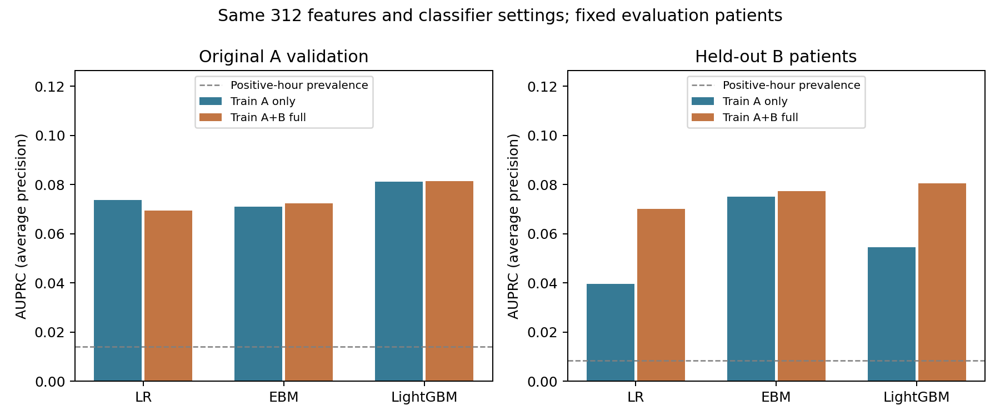
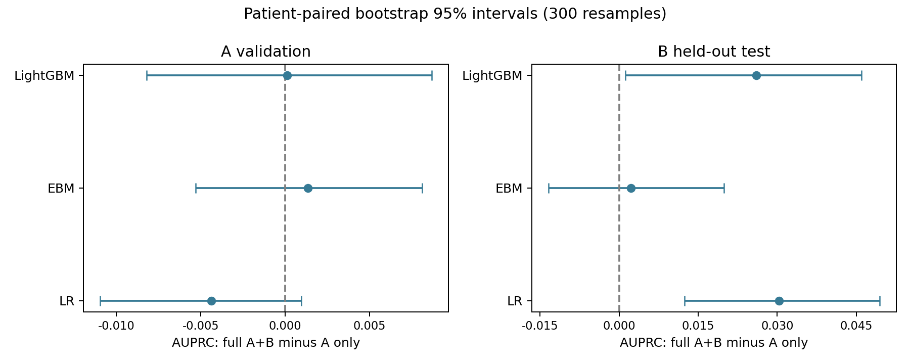
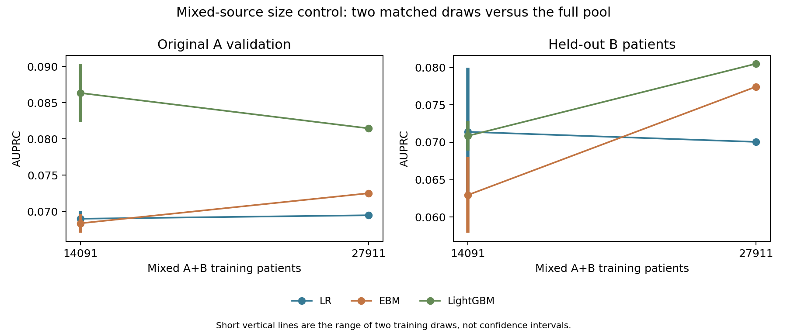

# A+B 训练扩充实验

本实验已经完成 14 组模型评价：复用 4 个 A-only 模型，新训练 10 个模型。原 A 训练/验证/测试名单及原始数据保持不变；A 测试集未评价。

## 本轮判断

主实验在 B 留出集上，LR、LightGBM 的扩充增益区间完全高于 0；在原 A 验证集上，无模型 的扩充增益区间完全高于 0。这些是未作多重校正的探索性、患者配对区间。扩充对不同医院和模型的影响不同，不能仅凭总小时记录增加就认定问题已解决。

总训练人数接近翻倍，发病患者增加约 57%。等规模 A+B 对照进一步显示：LR 的规模增益缺乏稳定支持；EBM 与原特征 LightGBM 在 B 测试上存在正向规模信号，但 A 验证未见明确收益，且 B 验证的规模差异区间仍跨 0。这些信号条件于两个训练抽样，仍需更多训练内重采样验证。两院测量缺失率存在很大差异，应同时处理数据来源分布、发病患者数量和模型复杂度。

## 实验回答什么

- A-only 与全量 A+B：评价加入医院 B 训练患者后的整体效果，同时改变了样本量、医院来源和病例比例，不能将差异全部归因于样本量。
- 两个等规模 A+B 对照与全量 A+B：按医院×发病状态比例抽样，两个种子均为 2026/2027；患者数与原 A 训练集一致，混合比例约相同，主要观察混合数据池内的规模效应。
- 主比较三个模型统一使用原 A 定义的 312 个特征。额外复核上一轮 349 特征、不裁剪、原生缺失的 LightGBM；两种特征方案分别比较，不混为模型架构效果。

## 队列与固定设置

| cohort | patients | event_patients | hours | positive_hours | positive_hour_prevalence | A_patients | A_event_patients | B_patients | B_event_patients |
| --- | --- | --- | --- | --- | --- | --- | --- | --- | --- |
| A_only | 14091 | 1109 | 469344 | 6654 | 0.0142 | 14091 | 1109 | 0 | 0 |
| A_B_full | 27911 | 1742 | 918004 | 10452 | 0.0114 | 14091 | 1109 | 13820 | 633 |
| A_B_matched_seed2026 | 14091 | 880 | 462881 | 5280 | 0.0114 | 7114 | 560 | 6977 | 320 |
| A_B_matched_seed2027 | 14091 | 880 | 463104 | 5280 | 0.0114 | 7114 | 560 | 6977 | 320 |

训练人数从 14,091 增加至 27,911，发病患者从 1,109 增加至 1,742，小时数从 469,344 增至 918,004。等规模混合对照只有 880 位发病患者，低于 A-only 的 1,109 位，这是保持全量混合池自然病例比例的结果。

B 在患者层面按发病状态分层，以种子 42 划为 70%/15%/15%。原 A 划分保留。全部评价队列如下：

| cohort | patients | event_patients | hours | positive_hours | positive_hour_prevalence | A_patients | A_event_patients | B_patients | B_event_patients |
| --- | --- | --- | --- | --- | --- | --- | --- | --- | --- |
| A_validation | 3020 | 238 | 101888 | 1428 | 0.0140 | 3020 | 238 | 0 | 0 |
| B_validation | 2961 | 136 | 96822 | 816 | 0.0084 | 0 | 0 | 2961 | 136 |
| B_test | 2962 | 136 | 95988 | 816 | 0.0085 | 0 | 0 | 2962 | 136 |

沿用六小时预测目标、六小时历史有效期、原固定超参数和内部患者级早停规则；没有类别重加权、过采样或重新调参。每个扩充队列单独拟合训练集插补、裁剪和标准化参数。原 A 全缺失而删除的特征不会因 B 数据可用而加入主实验。

每个模型只在同一个 A+B 混合验证集选择一个报警阈值，目标为每 100 个符合条件的患者小时不超过 1 次误报，报警后抑制重复报警 6 小时。阈值原样用于 A 验证、B 验证和 B 测试。A-only 仅指风险模型在 A 训练，阈值校准也使用 B 验证；因此它并非完全不接触 B 数据的部署方案。混合验证的误报限制不保证各医院分别达标，须读实际误报率。

## 主结果：小时级 AUPRC

| model | evaluation | A_B_full | A_only | change |
| --- | --- | --- | --- | --- |
| ebm | A_validation | 0.0725 | 0.0712 | 0.0014 |
| ebm | B_test | 0.0774 | 0.0752 | 0.0022 |
| lightgbm | A_validation | 0.0815 | 0.0813 | 0.0001 |
| lightgbm | B_test | 0.0805 | 0.0545 | 0.0260 |
| lr | A_validation | 0.0695 | 0.0739 | -0.0044 |
| lr | B_test | 0.0700 | 0.0397 | 0.0304 |

## 患者配对置信区间与等规模对照

下表为候选减参考的 AUPRC 差异；full_minus_mean_matched 比较全量与两个等规模对照的平均 AP，并非先平均预测概率。按评价患者重采样 300 次，报告 95% 百分位区间。

| model | evaluation | A_B_full | A_B_matched_seed2026 | A_B_matched_seed2027 | matched_mean | full_minus_matched_mean |
| --- | --- | --- | --- | --- | --- | --- |
| ebm | A_validation | 0.0725 | 0.0671 | 0.0697 | 0.0684 | 0.0041 |
| ebm | B_test | 0.0774 | 0.0680 | 0.0579 | 0.0629 | 0.0145 |
| lightgbm | A_validation | 0.0815 | 0.0904 | 0.0823 | 0.0863 | -0.0049 |
| lightgbm | B_test | 0.0805 | 0.0689 | 0.0728 | 0.0709 | 0.0096 |
| lr | A_validation | 0.0695 | 0.0680 | 0.0700 | 0.0690 | 0.0005 |
| lr | B_test | 0.0700 | 0.0799 | 0.0628 | 0.0714 | -0.0013 |

| profile | model | evaluation | contrast | difference | lower | upper |
| --- | --- | --- | --- | --- | --- | --- |
| common | lr | A_validation | full_minus_A_only | -0.0044 | -0.0110 | 0.0010 |
| common | lr | A_validation | full_minus_mean_matched | 0.0005 | -0.0021 | 0.0064 |
| common | ebm | A_validation | full_minus_A_only | 0.0014 | -0.0053 | 0.0081 |
| common | ebm | A_validation | full_minus_mean_matched | 0.0041 | -0.0016 | 0.0120 |
| common | lightgbm | A_validation | full_minus_A_only | 0.0001 | -0.0082 | 0.0087 |
| common | lightgbm | A_validation | full_minus_mean_matched | -0.0049 | -0.0133 | 0.0023 |
| enhanced_lightgbm | lightgbm | A_validation | full_minus_A_only | -0.0036 | -0.0135 | 0.0065 |
| common | lr | B_test | full_minus_A_only | 0.0304 | 0.0124 | 0.0495 |
| common | lr | B_test | full_minus_mean_matched | -0.0013 | -0.0115 | 0.0125 |
| common | ebm | B_test | full_minus_A_only | 0.0022 | -0.0134 | 0.0199 |
| common | ebm | B_test | full_minus_mean_matched | 0.0145 | 0.0031 | 0.0242 |
| common | lightgbm | B_test | full_minus_A_only | 0.0260 | 0.0012 | 0.0460 |
| common | lightgbm | B_test | full_minus_mean_matched | 0.0096 | 0.0001 | 0.0235 |
| enhanced_lightgbm | lightgbm | B_test | full_minus_A_only | 0.0151 | -0.0115 | 0.0338 |

区间仅反映给定已训练模型及两个训练子集条件下的评价患者不确定性，不包含重新训练的波动；两个训练抽样不足以给出完整的训练样本不确定性。多组探索性比较未作多重校正；不应以单个正向点估计宣称扩充稳定有效。

## 报警表现

| model | cohort | evaluation | event_sensitivity | alert_ppv | false_alerts_per_100_patient_hours | median_true_alert_lead_hours |
| --- | --- | --- | --- | --- | --- | --- |
| lr | A_only | A_validation | 0.4538 | 0.0771 | 1.2690 | 3.5000 |
| lr | A_only | B_test | 0.2206 | 0.0605 | 0.4855 | 3.0000 |
| ebm | A_only | A_validation | 0.4496 | 0.0834 | 1.1542 | 3.0000 |
| ebm | A_only | B_test | 0.2721 | 0.0678 | 0.5303 | 3.0000 |
| lightgbm | A_only | A_validation | 0.3950 | 0.0845 | 1.0001 | 3.0000 |
| lightgbm | A_only | B_test | 0.3603 | 0.0592 | 0.8116 | 3.0000 |
| lr | A_B_full | A_validation | 0.4160 | 0.0751 | 1.1964 | 3.0000 |
| lr | A_B_full | B_test | 0.3603 | 0.0778 | 0.6053 | 3.0000 |
| ebm | A_B_full | A_validation | 0.4454 | 0.0851 | 1.1179 | 3.0000 |
| ebm | A_B_full | B_test | 0.3824 | 0.0762 | 0.6563 | 3.0000 |
| lightgbm | A_B_full | A_validation | 0.4496 | 0.0836 | 1.1513 | 4.0000 |
| lightgbm | A_B_full | B_test | 0.3750 | 0.0697 | 0.7095 | 4.0000 |

## 上一轮 LightGBM 特征方案的扩充复核

| model | cohort | evaluation | auprc_average_precision | auroc | brier_score |
| --- | --- | --- | --- | --- | --- |
| lightgbm | A_only | A_validation | 0.0882 | 0.8252 | 0.0133 |
| lightgbm | A_only | B_test | 0.0556 | 0.7666 | 0.0083 |
| lightgbm | A_B_full | A_validation | 0.0846 | 0.8184 | 0.0133 |
| lightgbm | A_B_full | B_test | 0.0707 | 0.8012 | 0.0082 |

## 两院训练数据差异

下表按最近值缺失率的绝对差异列出最大的八个变量，仅使用 A/B 各自训练患者。数值为小时加权，不能代表患者层面的独立样本数量。完整的缺失率及观测分位数见 training_hospital_shift.csv，患者病例比例和可用时长见 training_patient_composition.csv。

| variable | A_train_latest_missing_rate | B_train_latest_missing_rate | B_minus_A_missing_rate |
| --- | --- | --- | --- |
| HCO3 | 0.5629 | 0.9941 | 0.4313 |
| Chloride | 0.5550 | 0.9704 | 0.4154 |
| DBP | 0.4187 | 0.0379 | -0.3808 |
| BaseExcess | 0.6161 | 0.9926 | 0.3765 |
| FiO2 | 0.5462 | 0.8833 | 0.3371 |
| pH | 0.5825 | 0.8874 | 0.3050 |
| PaCO2 | 0.6256 | 0.8871 | 0.2615 |
| PTT | 0.6952 | 0.9339 | 0.2387 |

## 解释边界与下一步

1. B 测试患者没有参与拟合或阈值选择，但其医院已经进入 A+B 训练。它属于同院未见患者检验，不能再称为独立外院验证；原来的跨院研究结果仍保留为历史实验。
2. B 患者此前整体被保留，当前按预先固定的划分对多个固定候选一次性评价，没有根据 B 测试选择特征或参数。原 A 验证已多次查看，本研究仍属于探索性分析。
3. 相同数值超参数在不同样本量下可能产生不同的有效正则化强度。本轮刻意固定参数，结论针对当前模型设置，不能证明增加数据在最优调参后一定无效或一定有效。
4. AUPRC 必须在同一评价队列内比较；A/B 患病率不同，不能直接用跨队列 AP 大小判断难度。完整 AUROC、Brier、训练 AP、早停树数、耗时与报警统计见 all_model_metrics.csv。
5. 下一轮先结合等规模对照判断规模效应，再在训练集内部交叉验证处理医院分布与正则化。继续保留 A 测试；若需要真正的外院验证，必须另找未参与训练的医院。

运行及验证方法见仓库 README 的 A+B expansion experiment。protocol.json、模型元数据、固定患者名单和校验记录与本报告一起保存；大型特征和模型仍分别存放在 processed_data/ab_expansion 与 outputs/ab_expansion。
