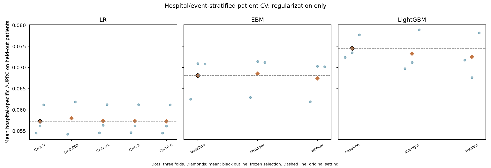
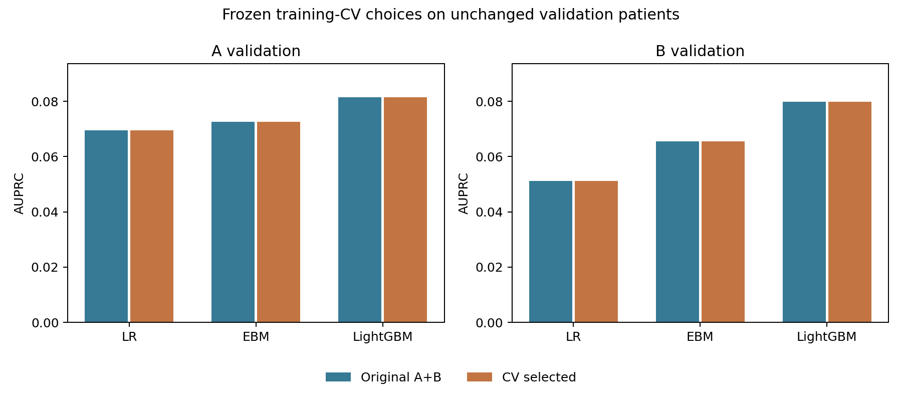
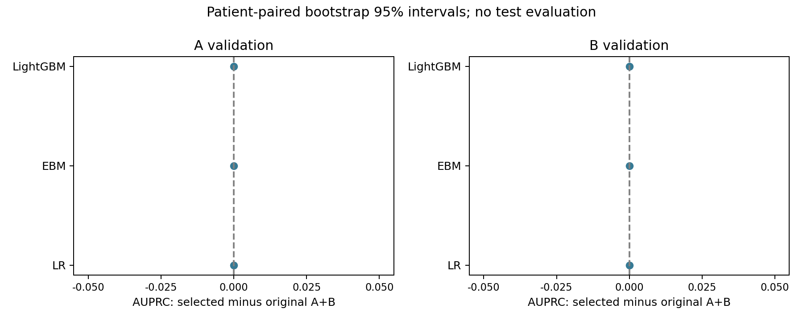
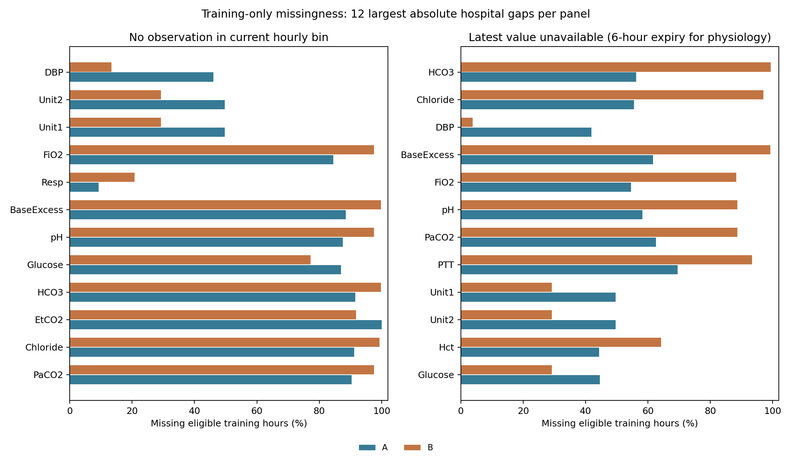
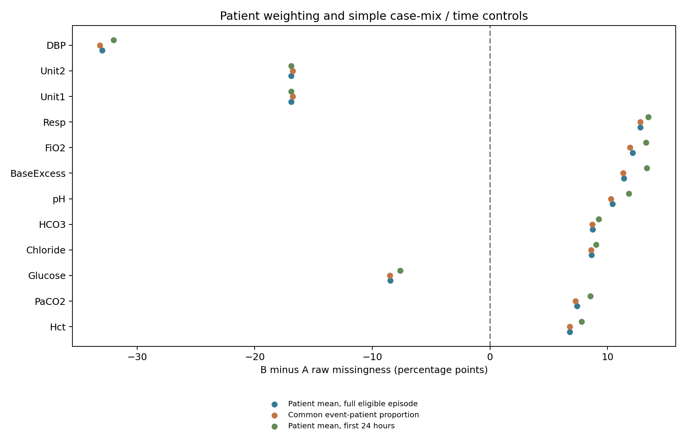
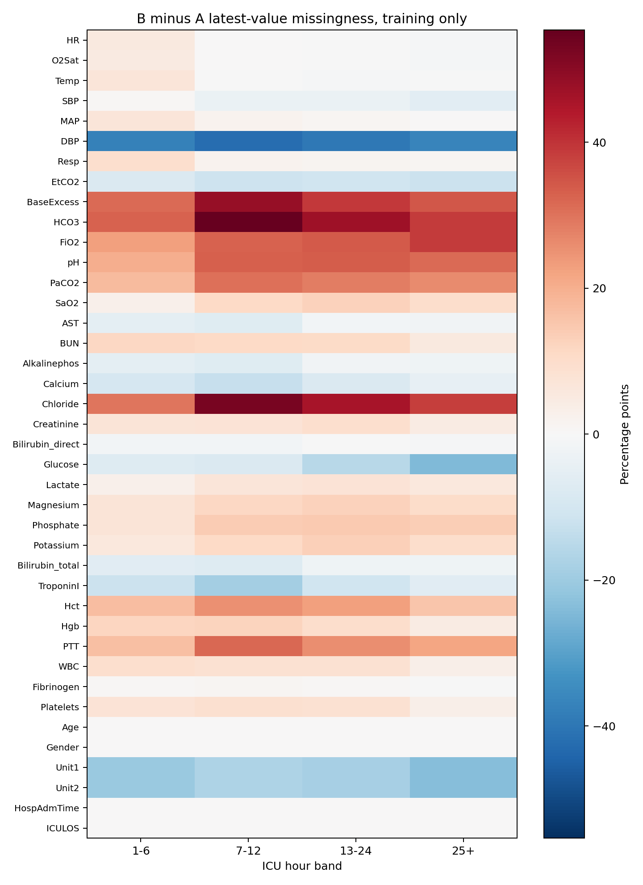

# A+B 医院分层交叉验证与正则化

在原有 A+B 训练池（27,911 位患者、1,742 位发病患者、918,004 条符合条件的小时记录）上完成 33 次 CV 拟合，固定 312 个特征，只改变正则化参数。现有 A/B 训练、验证和测试名单均未改变；本轮未评价任何测试集。

本轮训练内选择：**没有候选达到预先规定的替换门槛，三个模型均保留原设置**。固定验证集上，增益区间完全高于 0 的模型为：A_validation：无；B_validation：无。这些是未作多重校正的探索性比较，不能将训练 CV 的改进直接等同于验证集收益。

三条所选模型评价记录中，3 条直接复用了原 A+B 模型权重。保留原模型时，验证差值及其配对区间为 0，表示相同权重的比较，不是重新训练后波动的估计。

两院缺失差异在患者等权、统一发病比例和前 24 小时对照后仍然明显；仅凭训练患者的缺失比例识别医院，OOF AUROC 为 0.9995。这支持记录分布存在强烈的医院来源差异；其对 sepsis 预测误差的因果影响还需训练内消融检验。

## 训练内选择结果

| model | candidate | mean_macro_auprc | mean_A_auprc | mean_B_auprc | mean_gain_vs_baseline | improved_folds |
| --- | --- | --- | --- | --- | --- | --- |
| ebm | baseline | 0.0681 | 0.0678 | 0.0683 | 0.0000 | 0 |
| lightgbm | baseline | 0.0745 | 0.0775 | 0.0716 | 0.0000 | 0 |
| lr | baseline | 0.0573 | 0.0613 | 0.0533 | 0.0000 | 0 |

完整参数见 protocol.json 的 candidates。LR 比较 C=0.001/0.01/0.1/1/10；EBM 联合比较 (min_samples_leaf, reg_lambda)=(200,10)/(400,50)/(800,100)；LightGBM 联合比较 (min_child_samples, reg_lambda)=(100,1)/(200,10)/(400,50)。树的叶子数量、分箱、学习率和迭代上限等保持原设置；联合设置的效果不能拆解为单个参数的因果效果。

三折按患者分组，并对医院×发病状态分层，种子 2026。同一患者全部小时属于同一折。每折单独拟合插补、裁剪和标准化；只使用该折训练患者，外折患者不进入预处理拟合。内部早停沿用原先按发病状态分层的患者袋，全部来自该外折训练分区。

选择指标先在 A、B 各自计算 AUPRC，再对两院取平均，最后对三折取平均。候选必须比原设置提升至少 0.001，且至少改善两折，才有资格替换原设置；否则保留 baseline。selection.json 在外层验证评价之前保存，外层验证指标不参与选择。折间标准差不是置信区间，OOF 指标与用于选择的平均折指标分别保存。

## 固定 A/B 验证集结果

| model | selected_candidate | evaluation | baseline_auprc | selected_auprc | ap_difference | difference_lower | difference_upper | baseline_auroc | selected_auroc | baseline_brier | selected_brier |
| --- | --- | --- | --- | --- | --- | --- | --- | --- | --- | --- | --- |
| lr | baseline | A_validation | 0.0695 | 0.0695 | 0.0000 | 0.0000 | 0.0000 | 0.7859 | 0.7859 | 0.0135 | 0.0135 |
| lr | baseline | B_validation | 0.0512 | 0.0512 | 0.0000 | 0.0000 | 0.0000 | 0.8153 | 0.8153 | 0.0083 | 0.0083 |
| ebm | baseline | A_validation | 0.0725 | 0.0725 | 0.0000 | 0.0000 | 0.0000 | 0.8071 | 0.8071 | 0.0134 | 0.0134 |
| ebm | baseline | B_validation | 0.0656 | 0.0656 | 0.0000 | 0.0000 | 0.0000 | 0.8360 | 0.8360 | 0.0081 | 0.0081 |
| lightgbm | baseline | A_validation | 0.0815 | 0.0815 | 0.0000 | 0.0000 | 0.0000 | 0.8168 | 0.8168 | 0.0133 | 0.0133 |
| lightgbm | baseline | B_validation | 0.0799 | 0.0799 | 0.0000 | 0.0000 | 0.0000 | 0.8485 | 0.8485 | 0.0080 | 0.0080 |

这些外层验证集此前已经查看过，当前结果仍属于探索性分析。表中差值为所选模型减原 A+B 模型，按评价患者配对重采样 300 次；区间条件于已选定模型，不包含再次调参或重新训练的波动，多组比较未做多重校正。

本轮没有重新评分 B 测试患者，也没有使用仍保留的 A 测试。B 在上一轮已经进入训练，因此后续 B 留出评价仍属于同院未见患者检验，不能恢复为独立外院验证。

## 报警评价

每个所选模型在相同的 A+B 混合验证集校准一个阈值，目标为每 100 个符合条件的患者小时不超过 1 次误报，报警后抑制 6 小时。该混合预算不保证每个医院分别达标。原模型参考阈值来自上一轮同一混合验证队列。

| model | method | evaluation | event_sensitivity | alert_ppv | false_alerts_per_100_patient_hours | median_true_alert_lead_hours |
| --- | --- | --- | --- | --- | --- | --- |
| lr | baseline | A_validation | 0.4160 | 0.0751 | 1.1964 | 3.0000 |
| lr | baseline | B_validation | 0.3971 | 0.0801 | 0.6404 | 3.0000 |
| lr | baseline | pooled_validation | 0.4091 | 0.0768 | 0.9255 | 3.0000 |
| lr | selected | A_validation | 0.4160 | 0.0751 | 1.1964 | 3.0000 |
| lr | selected | B_validation | 0.3971 | 0.0801 | 0.6404 | 3.0000 |
| lr | selected | pooled_validation | 0.4091 | 0.0768 | 0.9255 | 3.0000 |
| ebm | baseline | A_validation | 0.4454 | 0.0851 | 1.1179 | 3.0000 |
| ebm | baseline | B_validation | 0.4632 | 0.0900 | 0.6579 | 3.0000 |
| ebm | baseline | pooled_validation | 0.4519 | 0.0869 | 0.8938 | 3.0000 |
| ebm | selected | A_validation | 0.4454 | 0.0851 | 1.1179 | 3.0000 |
| ebm | selected | B_validation | 0.4632 | 0.0900 | 0.6579 | 3.0000 |
| ebm | selected | pooled_validation | 0.4519 | 0.0869 | 0.8938 | 3.0000 |
| lightgbm | baseline | A_validation | 0.4496 | 0.0836 | 1.1513 | 4.0000 |
| lightgbm | baseline | B_validation | 0.5000 | 0.0895 | 0.7147 | 3.0000 |
| lightgbm | baseline | pooled_validation | 0.4679 | 0.0858 | 0.9386 | 3.0000 |
| lightgbm | selected | A_validation | 0.4496 | 0.0836 | 1.1513 | 4.0000 |
| lightgbm | selected | B_validation | 0.5000 | 0.0895 | 0.7147 | 3.0000 |
| lightgbm | selected | pooled_validation | 0.4679 | 0.0858 | 0.9386 | 3.0000 |

验证集上选择阈值并在同一集合报告的报警表现可能乐观；当前结果用于研究比较。训练模型与预处理、早停分组、阈值和预测都保存在 outputs/ab_regularization 下。

## 两院训练数据的缺失差异

原始小时缺失指该小时没有观测；最近值缺失指六小时有效期后仍没有可用生理指标。背景变量保持当前值，不做该生理指标有效期处理。以下比例均为 0–1，0.10 表示 10%。全部分析仅使用训练患者及其符合条件的小时，不包含外层验证或测试患者。

| variable | A_raw_hour_missing_rate | B_raw_hour_missing_rate | A_latest_hour_missing_rate | B_latest_hour_missing_rate |
| --- | --- | --- | --- | --- |
| DBP | 0.4608 | 0.1343 | 0.4187 | 0.0379 |
| Unit2 | 0.4971 | 0.2923 | 0.4971 | 0.2923 |
| Unit1 | 0.4971 | 0.2923 | 0.4971 | 0.2923 |
| FiO2 | 0.8455 | 0.9753 | 0.5462 | 0.8833 |
| Resp | 0.0922 | 0.2079 | 0.0309 | 0.0615 |
| BaseExcess | 0.8857 | 0.9977 | 0.6161 | 0.9926 |
| pH | 0.8755 | 0.9757 | 0.5825 | 0.8874 |
| Glucose | 0.8701 | 0.7723 | 0.4464 | 0.2917 |
| HCO3 | 0.9153 | 0.9981 | 0.5629 | 0.9941 |
| EtCO2 | 1.0000 | 0.9181 | 1.0000 | 0.8917 |

## 记录长度与病例比例对照

下表为 B 减 A 的原始缺失率差：先让每位患者等权，再将两院发病患者比例统一到训练池的 6.2413%，并另看每位患者前 24 小时。病例比例标准化只处理发病状态构成，不是年龄、严重度或其他临床因素的因果调整；小时分组也不能排除记录结束和队列选择造成的偏差。

| variable | B_minus_A_raw_patient_mean_missing_rate | B_minus_A_raw_event_standardized_patient_missing_rate | B_minus_A_raw_first24_patient_mean_missing_rate |
| --- | --- | --- | --- |
| DBP | -0.3298 | -0.3316 | -0.3201 |
| Unit2 | -0.1691 | -0.1676 | -0.1691 |
| Unit1 | -0.1691 | -0.1676 | -0.1691 |
| Resp | 0.1276 | 0.1278 | 0.1346 |
| FiO2 | 0.1212 | 0.1190 | 0.1325 |
| BaseExcess | 0.1137 | 0.1130 | 0.1333 |
| pH | 0.1041 | 0.1029 | 0.1179 |
| HCO3 | 0.0871 | 0.0870 | 0.0925 |

缺失模式辨别医院的诊断实验，使用每位训练患者全段符合条件记录的 40 项原始缺失比例，采用相同三折、折内标准化和固定 LR，医院 B 为正类；OOF AUROC 为 **0.9995**。这量化了两院记录模式的可区分程度。全段聚合仅用于该诊断，未进入逐小时 sepsis 模型，医院编号也未作为 sepsis 模型输入。

明显的缺失分布差异支持医院来源偏移确实存在；单凭该分析不能断定缺失导致了预测失败，也不能判断记录错误。主模型的缺失标记、观测次数与测量间隔可能携带医院流程信息，同时也可能携带有效风险信息。三种所选模型的特征重要性表保存了这些特征的标记；重要性受特征相关性影响，不等于因果贡献，三个模型的重要性尺度不能直接比较。

## 后续建议与复现

按用户补充要求，另计算 [完整轨迹官方 Utility Score](utility/report.md)，比较 A-only、A+B 原参数与本轮 CV 所选模型。该项使用未再平移的原始标签、完整小时轨迹及既定阈值，采用固定版本的 [官方评分代码](https://github.com/physionetchallenges/evaluation-2019)，不参与正则化或阈值选择；与本报告的发病前任务分开解释。

先据固定验证结果判断正则化是否带来可重复的改进。若增益有限，下一轮可在训练内预先设计缺失信息消融，以及医院分层的概率校准/报警预算比较；不能从目前缺失率差异直接推导哪一种处理必然改善效果。保留现有测试患者，外院泛化仍需要未参与训练的新医院。

运行命令、缓存目录及校验方式见仓库 README。protocol.json 和 selection.json 分别记录训练前设计与训练内选择，patient_cv_folds.csv 保存固定折名单；model_metadata_archive.json 归档 36 个小型模型结果记录。大型模型、预测和矩阵保存在本地的 outputs/ab_regularization、processed_data/ab_regularization，未加入 Git。
